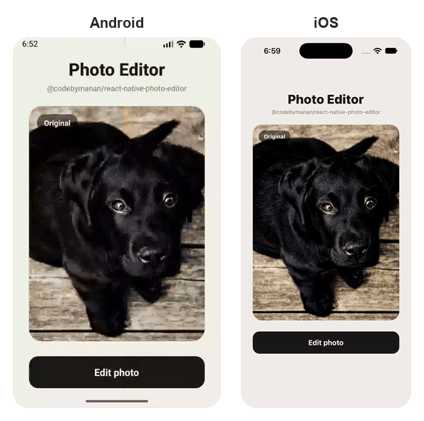

# @codebymanan/react-native-photo-editor

A React Native photo editor plugin wrapping native editors for Android and iOS.
Call `open()` with an image, the user edits it in a full-screen native editor,
and you get back the path of the edited file.

<p align="center">
  
</p>

<p align="center"><sub>Android (left) and iOS (right). Photo by André Spieker on Unsplash.</sub></p>

## Features

Each platform uses a mature native editor, so the toolsets differ slightly:

| | Android | iOS |
| --- | :---: | :---: |
| Freehand drawing and eraser | ✓ | ✓ |
| Shapes (line, arrow, oval, rectangle) | ✓ | |
| Text | ✓ | ✓ |
| Emoji | ✓ | |
| Your own image stickers | ✓ | ✓ |
| Filters | ✓ | ✓ |
| Crop and rotate | | ✓ |
| Mosaic | | ✓ |
| Brightness, contrast and saturation sliders | | ✓ |
| Undo and redo | ✓ | ✓ |
| Localized UI, including right-to-left | ✓ | ✓ |

Android uses [PhotoEditor](https://github.com/burhanrashid52/PhotoEditor) and iOS
uses [ZLImageEditor](https://github.com/longitachi/ZLImageEditor).

## Requirements

- React Native with the New Architecture enabled, which is the default since
  0.76. Tested on 0.85 and 0.88.
- iOS: the minimum version your React Native version supports.
- Android: `minSdkVersion` 24.

## Installation

```sh
npm install @codebymanan/react-native-photo-editor
# or
yarn add @codebymanan/react-native-photo-editor
```

On iOS, install the pods:

```sh
cd ios && bundle exec pod install
# or, from the project root
npx pod-install
```

Android needs no extra step; autolinking picks the library up.

Then **rebuild the app** (`npx react-native run-ios` / `run-android`, or build
from Xcode / Android Studio). Reloading JavaScript is not enough: until the
native code is compiled into the app, importing the library throws
*"TurboModuleRegistry.getEnforcing(...): 'PhotoEditor' could not be found"*.

### Expo

The library contains native code, so it does not run in Expo Go. In a
[development build](https://docs.expo.dev/develop/development-builds/introduction/)
it is autolinked like any other native library, with no config plugin:

```sh
npx expo install @codebymanan/react-native-photo-editor
npx expo prebuild
```

If you pass `ph://` URIs on iOS, add `NSPhotoLibraryUsageDescription` under
`ios.infoPlist` in your app config (see [below](#photo-library-uris-on-ios)).

### iOS editor version

On iOS the editor is [ZLImageEditor](https://github.com/longitachi/ZLImageEditor).
Its 4.x line adds layout support for iPhone Duo and iPad multi-window, but it
only compiles with **Xcode 27.1 or newer**. So `pod install` picks the version
for you based on the Xcode it finds:

| Xcode at `pod install` | ZLImageEditor |
| --- | --- |
| 27.1 or newer | 4.x |
| older | 3.x |

Both work with every option this library offers. To choose explicitly, set this
at the top of `ios/Podfile`:

```ruby
ENV['PHOTO_EDITOR_ZLIMAGEEDITOR_VERSION'] = '3.0' # or '4.0'
```

Pin it when the machine that runs `pod install` is not the one that builds,
for example a CI image on an older Xcode, or when your team shares a
`Podfile.lock` across Xcode versions.

After changing the variable or upgrading Xcode, run
`pod update ZLImageEditor` once. A plain `pod install` stops with *"could not
find compatible versions for pod ZLImageEditor"*, because `Podfile.lock` still
holds the previous version.

## Usage

```js
import { open } from '@codebymanan/react-native-photo-editor';

const editedPath = await open({
  path: 'https://example.com/photo.jpg',
  stickers: ['https://example.com/sticker.png'],
});
```

`open()` resolves with the file path of the edited image, or rejects with
`E_CANCELLED` if the user backs out (see [Errors](#errors)).

| Option | Type | Description |
| --- | --- | --- |
| `path` | `string` | **Required.** Image to edit. Accepts a local file path, a `file://` URI, a remote `http(s)` URL, a `content://` URI (Android) or a `ph://` photo library URI (iOS, see below). |
| `stickers` | `string[]` | Sticker images shown in the sticker picker, as remote URLs or local paths. The sticker tool only appears when this is non-empty. |
| `language` | `string` | BCP-47 tag (`'fr'`, `'pt-BR'`, `'zh-Hans'`) for the editor UI. Defaults to the device language. See [Localization](#localization). |
| `translations` | `Record<string, string>` | Per-key string overrides. See [Localization](#localization). |

### The edited file

The resolved value is an absolute path **without** a `file://` prefix, always
to a PNG. Add the prefix when you hand it to an `<Image>`:

```js
<Image source={{ uri: `file://${editedPath}` }} />
```

The file lives in the app's cache directory on Android and its temporary
directory on iOS. The library never deletes these files, and the operating
system may clear those directories when it needs space, so move the file
somewhere permanent (or upload it) if you need to keep it, and delete it when
you are done.

### Stickers

Pass the images you want in the sticker picker as `stickers`. Each entry is a
remote `http(s)` URL or a path to a file on the device; transparent PNGs work
best.

```js
const STICKERS = [
  'https://example.com/stickers/heart.png',
  'https://example.com/stickers/star.png',
  `${RNFS.DocumentDirectoryPath}/stickers/smile.png`, // a file you saved earlier
];

await open({ path, stickers: STICKERS });
```

The user opens the sticker tool, taps a sticker to drop it onto the photo, then
drags, pinches and rotates it into place. Stickers load in the background, so
remote ones appear in the picker as they arrive.

Images bundled with `require('./sticker.png')` are not file paths in release
builds, so they cannot be passed directly. Host them remotely or copy them to
the device first.

When `stickers` is omitted or empty, both platforms hide the sticker tool.

### Photo library URIs on iOS

`ph://` URIs, as returned by pickers such as
`@react-native-camera-roll/camera-roll`, are loaded through the Photos
framework. iCloud-only photos are downloaded on demand. Your app needs an
`NSPhotoLibraryUsageDescription` entry in its `Info.plist`; if the user has
never been asked, the editor asks for access before loading the photo.

## Localization

By default the editor follows the device language on both platforms. Pass
`language` only when your app has its own language picker and the editor should
follow that instead:

```js
await open({ path, language: 'fr' });
```

### iOS

The iOS editor already ships 18 languages and follows the device locale with no
setup. Nothing to configure.

`language` maps onto those 18: Chinese (Simplified and Traditional), English,
Japanese, French, German, Russian, Vietnamese, Korean, Malay, Italian,
Indonesian, Portuguese, Spanish, Turkish, Arabic, Ukrainian and Dutch. A tag
outside that set falls back to English rather than to the device language,
since the caller has explicitly asked not to use the device setting.

### Android

The Android editor ships English only, but every user-facing string is a normal
Android string resource, so **your app can translate it without forking this
library**.

Add a `values-<language>` folder to your own app and redefine the keys you care
about. Android's resource merger gives your app priority over library
resources, so your values win:

```xml
<!-- android/app/src/main/res/values-fr/strings.xml -->
<resources>
    <string name="pe_label_brush">Pinceau</string>
    <string name="pe_label_save">Enregistrer</string>
    <string name="pe_msg_saving">Enregistrement…</string>
</resources>
```

That's the whole mechanism. Four things worth knowing:

- **Override only what you need.** Keys you leave out fall back to this
  library's English.
- **Any language works**, including ones this library has never heard of. The
  key names are the only contract.
- **Match the qualifier.** Overriding a key in the default `values/` folder does
  *not* win against a more specific match. Put French overrides in
  `values-fr/`, German in `values-de/`, and so on.
- **`language` selects the folder, it does not create one.** Passing
  `language: 'fr'` makes the editor resolve strings against `values-fr/`; if
  your app has no `values-fr/`, the editor stays in English. The example app
  ships one to demonstrate this.

### Supplying strings from JS

`translations` overrides individual strings by key, for when your copy lives in
JS rather than in native resources, or when you need a language iOS does not
ship:

```js
await open({
  path,
  language: 'sv',
  translations: {
    pe_label_save: 'Spara',
    pe_label_cancel: 'Avbryt',
    pe_msg_saving: 'Sparar…',
  },
});
```

Keys you leave out keep their built-in value, and on Android a `values-<lang>`
folder still applies underneath, so the two mechanisms stack: resources for the
bulk, `translations` for whatever you want to override per call.

**Android honours every key below. iOS honours nine of them** — the only strings
the underlying editor exposes — and ignores the rest. That asymmetry is the
reason to reach for a `values-<lang>` folder first on Android and treat
`translations` as the cross-platform layer on top.

#### String keys

| Key | English | iOS |
| --- | --- | --- |
| `pe_app_name` | Photo Editor | |
| `pe_label_brush` | Brush | |
| `pe_label_shape` | Shape | |
| `pe_label_oval` | Oval | |
| `pe_label_rectangle` | Rectangle | |
| `pe_label_line` | Line | |
| `pe_label_arrow` | Arrow | |
| `pe_label_emoji` | Emoji | |
| `pe_label_sticker` | Sticker | |
| `pe_label_eraser` | Eraser | |
| `pe_label_eraser_mode` | Eraser Mode | |
| `pe_label_text` | Text | |
| `pe_label_filter` | Filter | |
| `pe_label_adjust` | Adjust | |
| `pe_label_opacity` | Opacity | |
| `pe_label_undo` | Undo | ✓ |
| `pe_label_redo` | Redo | |
| `pe_label_close` | Close | |
| `pe_label_done` | Done | ✓ |
| `pe_label_save` | Save | ✓ |
| `pe_label_cancel` | Cancel | ✓ |
| `pe_label_discard` | Discard | |
| `pe_msg_save_image` | Do you want to exit without saving the image? | |
| `pe_msg_saving` | Saving… | ✓ |
| `pe_msg_save_failed` | Failed to save image | |
| `pe_msg_drag_to_remove` | *(iOS only)* Drag here to remove | ✓ |
| `pe_filter_none` | None | |
| `pe_filter_auto_fix` | Auto Fix | |
| `pe_filter_brightness` | Brightness | ✓ |
| `pe_filter_contrast` | Contrast | ✓ |
| `pe_filter_documentary` | Documentary | |
| `pe_filter_duo_tone` | Duo Tone | |
| `pe_filter_fill_light` | Fill Light | |
| `pe_filter_fish_eye` | Fish Eye | |
| `pe_filter_grain` | Grain | |
| `pe_filter_gray_scale` | Grayscale | |
| `pe_filter_lomish` | Lomish | |
| `pe_filter_negative` | Negative | |
| `pe_filter_posterize` | Posterize | |
| `pe_filter_saturate` | Saturate | ✓ |
| `pe_filter_sepia` | Sepia | |
| `pe_filter_sharpen` | Sharpen | |
| `pe_filter_temperature` | Temperature | |
| `pe_filter_tint` | Tint | |
| `pe_filter_vignette` | Vignette | |
| `pe_filter_cross_process` | Cross Process | |
| `pe_filter_black_white` | Black & White | |
| `pe_filter_flip_horizontal` | Flip Horizontal | |
| `pe_filter_flip_vertical` | Flip Vertical | |
| `pe_filter_rotate` | Rotate | |

### Right-to-left languages

**Android** mirrors the editor for an RTL tag such as `language: 'ar'`, but only
if your app has opted into RTL at all:

```xml
<!-- android/app/src/main/AndroidManifest.xml -->
<application android:supportsRtl="true">
```

Without that flag Android pins the whole app to left-to-right and the editor
cannot override it. The editor's own layouts use `start`/`end` throughout and
the undo and redo arrows are `autoMirrored`, so nothing else is needed.

**iOS** translates but does not mirror. `language` selects the editor's string
bundle; UIKit takes layout direction from the app's own localizations, and the
underlying editor never sets `semanticContentAttribute`. So the iOS editor lays
out right-to-left when your app itself is running in an RTL language, and not
because of this option.

## Errors

`open()` rejects with one of these codes on `error.code`:

| Code | When |
| --- | --- |
| `E_CANCELLED` | The user closed the editor without saving. Usually not an error worth showing. |
| `E_IN_PROGRESS` | `open()` was called while another editor session was still open. |
| `E_INVALID_OPTIONS` | `path` was missing or empty. |
| `E_NO_ACTIVITY` | There was no screen to present the editor from, e.g. the app was in the background. |
| `E_FAILED` | The image could not be loaded or saved. `error.message` says which, including a missing photo library permission on iOS. |

```js
try {
  const edited = await open({ path });
} catch (e) {
  if (e.code !== 'E_CANCELLED') {
    console.warn(e.code, e.message);
  }
}
```

## Testing with Jest

The native module is not available under Jest. Mock it with the bundled stub,
whose `open` resolves with a fake path and can be overridden per test:

```js
// jest.setup.js
jest.mock('@codebymanan/react-native-photo-editor', () =>
  require('@codebymanan/react-native-photo-editor/jest/mock')
);
```

```js
import { open } from '@codebymanan/react-native-photo-editor';

open.mockRejectedValueOnce(
  Object.assign(new Error('cancelled'), { code: 'E_CANCELLED' })
);
```

## Contributing

- [Development workflow](CONTRIBUTING.md#development-workflow)
- [Sending a pull request](CONTRIBUTING.md#sending-a-pull-request)
- [Code of conduct](CODE_OF_CONDUCT.md)

## License

MIT. The Android editor screen is adapted from the
[PhotoEditor](https://github.com/burhanrashid52/PhotoEditor) sample app; see
[THIRD_PARTY_NOTICES.md](THIRD_PARTY_NOTICES.md).

---

Made with [create-react-native-library](https://github.com/callstack/react-native-builder-bob)
